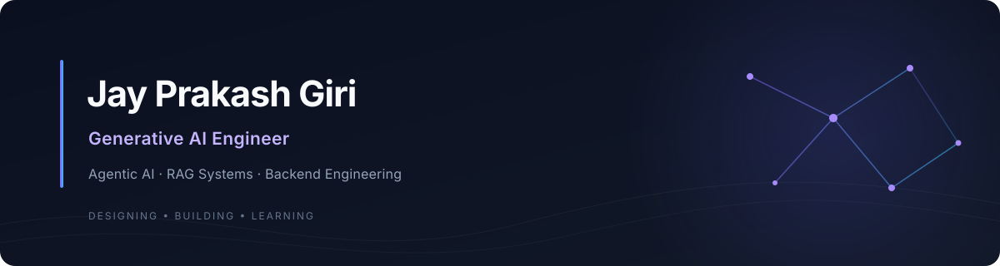

  

   

  
  
  

    

  
  
  

 

### 🧠 About Me

> _"I make LLMs think, agents act, and occasionally spend hours figuring out why they don't."_

I'm Jay Prakash Giri, a **Systems Engineer at Tata Consultancy Services (TCS)**, working in the Generative AI domain.

I enjoy turning ideas into practical AI applications, exploring **RAG architectures, agentic workflows, and LLM-powered systems**.

My work and learning revolve around Python, LangChain, LangGraph, FastAPI, vector databases, and backend engineering. I'm particularly interested in building AI systems that are useful, reliable, and scalable.

### 🚀 Professional Journey

<table>
  <tr>
    <td valign="top" align="center" width="45">
      <b>🟢</b> 
      │
    </td>
    <td valign="top">
      <h3>Systems Engineer | Tata Consultancy Services</h3>
      <b>Generative AI</b> · Bhubaneswar, India · Present
      

        Working in the Generative AI domain, exploring LLM-powered applications,
        RAG architectures, and agentic AI workflows.
      

    </td>
  </tr>
  <tr>
    <td valign="top" align="center" width="45">
      <b>🔵</b>
    </td>
    <td valign="top">
      <h3>Programmer Analyst Trainee | Cognizant</h3>
      SAP ABAP · Bengaluru, India · 2025–2026
      

        Worked in SAP ABAP and gained experience in enterprise application
        development and SAP backend technologies.
      

    </td>
  </tr>
</table>

### 🛠️ The Engineering Stack

<table>
  <tr>
    <td width="50%" valign="top">
      <h3>🧠 Intelligence Layer</h3>
      
Building context-aware AI and agentic workflows.

      

        
        
        
        
        
      

    </td>
    <td width="50%" valign="top">
      <h3>⚙️ Application Layer</h3>
      
Turning AI capabilities into usable applications.

      

        
        
        
        
        
      

    </td>
  </tr>
  <tr>
    <td width="50%" valign="top">
      <h3>🗄️ Data & Memory Layer</h3>
      
Managing structured data and semantic retrieval.

      

        
        
        
        
        
      

    </td>
    <td width="50%" valign="top">
      <h3>☁️ Infrastructure & Tools</h3>
      
Building, versioning, and deploying applications.

      

        
        
        
        
        
      

    </td>
  </tr>
</table>

## Selected Projects

### [Medical AI Chatbot](https://github.com/jaygiri0111/Medical-AI-Chatbot)
A document-grounded medical information chatbot built as an exploration of conversational AI and retrieval-based question answering.

**Stack:** Python · LangChain · Flask · Pinecone · LLMs

### [American Sign Language Detection](https://github.com/jaygiri0111/American-Sign-Language-Detection-Using-CNN)
A computer-vision project that recognizes American Sign Language finger-spelling gestures and converts predictions into text and speech.

**Stack:** Python · CNN · TensorFlow/Keras · MediaPipe · OpenCV

### [Predictive Maintenance Analysis](https://github.com/jaygiri0111/Predictive-Maintenance-Analysis)
A machine-learning project for analysing industrial sensor data and predicting equipment failure patterns.

**Stack:** Python · Machine Learning · Pandas

[View the live demo](https://predictive-maintenance-analysis-8pz7rtko4qhdf8ffj6jxde.streamlit.app/)

## GitHub Activity

  
  

---

  Always learning. Building thoughtfully. Improving with every iteration.

